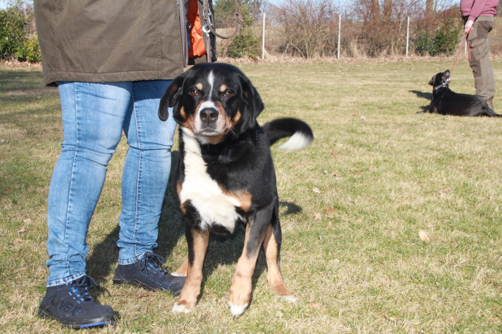
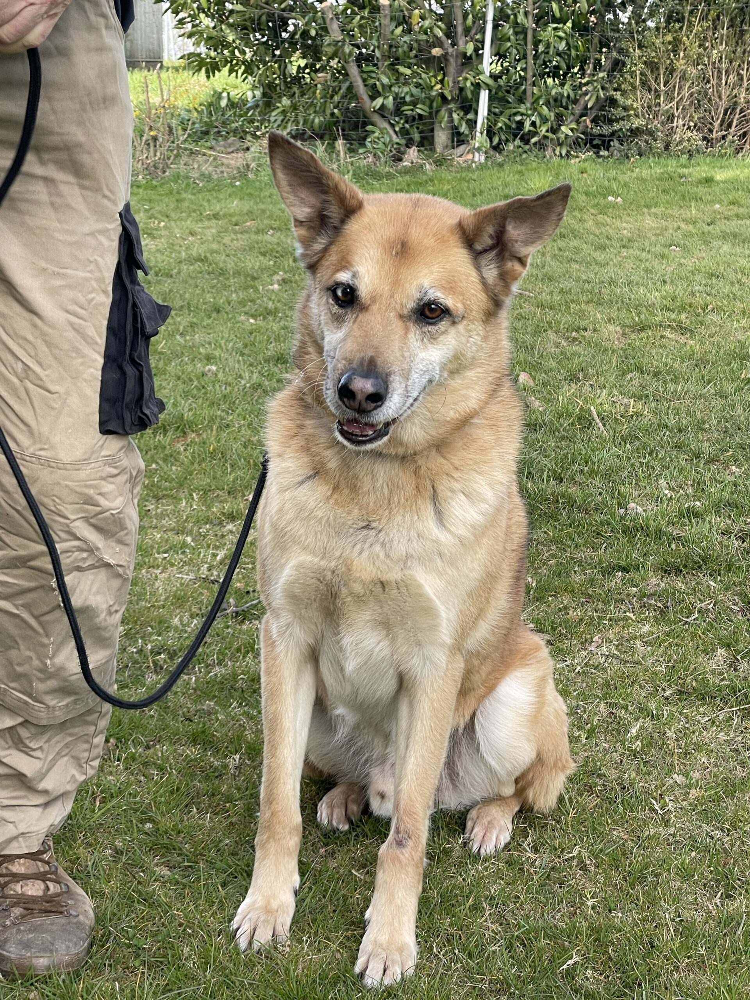
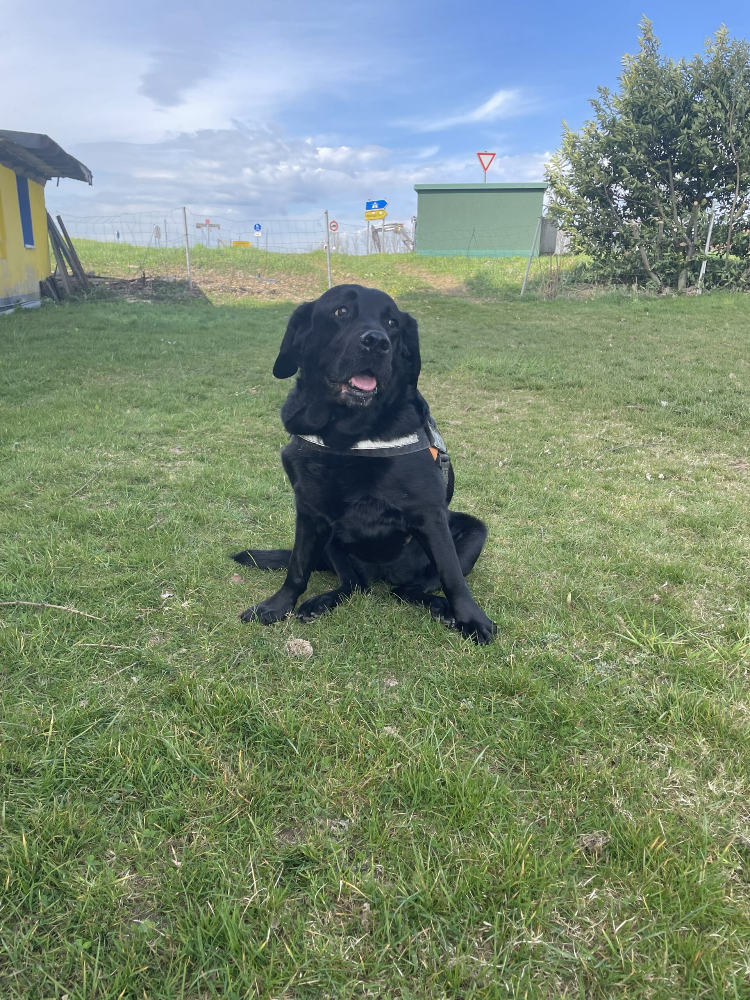
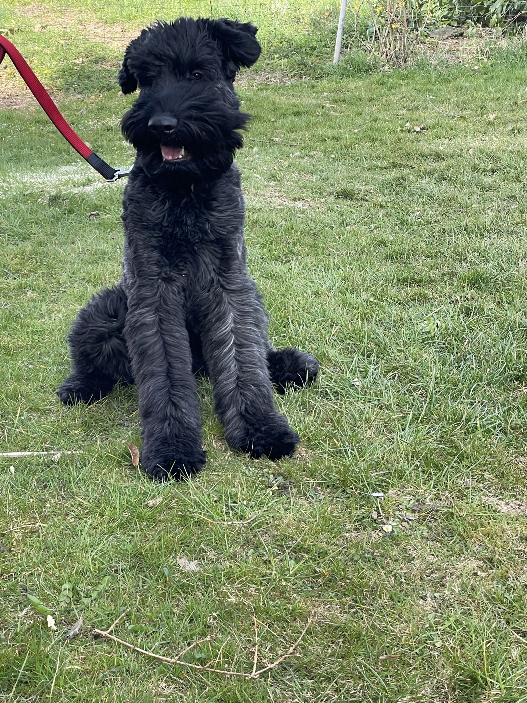
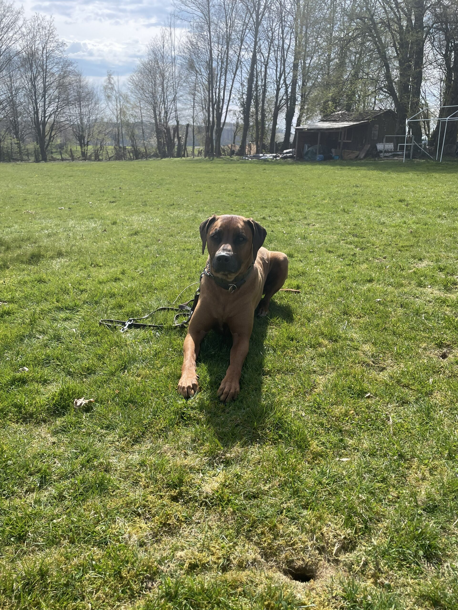

+++
title = "Unsere Hunde"
aliases = ["/unsere-hunde-2-2/", "/unsere-hunde-2-3/"]
+++
<!-- (C) PSK OG Marienheide e.V., VR/Köln 1369 -->



















\
Whisky, \*12.04.2010;BH/VT

Maxx

Hedwig

Lenox

Nelson

















## Weitere Einblicke

- [In Memoriam](/unsere-hunde-2-2/in-memoriam/)
- [Galerie](/galerie/)
